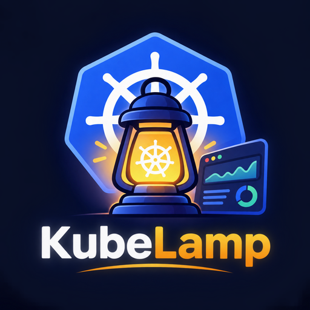

<p align="center"></p>

# KubeLamp

KubeLamp (formerly KubeDeck) is a lightweight, Headlamp-style Kubernetes dashboard for every cluster in your kubeconfig.

Point it at your kubeconfig and you get one web app for all your contexts. You can see live metrics, manage any resource, exec into pods, and run a real shell with `kubectl` already pointed at the cluster you're viewing.

- **One small binary** (about 8 MB) with nothing to install in the cluster. There is no Node, Python or database. The only bundled extras are xterm.js and IBM Plex fonts.
- **Works with any kubeconfig**, including:
  - kubeadm client certificates
  - EKS (`aws eks get-token`) and other `exec` plugins
  - bearer tokens
  - Rancher proxy URLs
  - `proxy-url`
  - several files merged together
- **Works with only Roles and RoleBindings.** If your user has no cluster-wide rights, KubeLamp reads just your namespaces. It detects this automatically, or you can set it per cluster.

## Features

**Every cluster at a glance:** health, versions, nodes, pods, Deployments, warnings, and CPU and memory against capacity or quota.

**Metrics:**
- **Charts for the last hour:** cluster, node, workload and pod, with usage against requests, limits and allocatable.
- **Breakdowns:** CPU and memory by namespace, and the top pods by each.
- **Health:** node pressure and pods that need attention.

**Every resource type, including CRDs.** KubeLamp asks each cluster which resource types it serves and builds the navigation from that:
- **Workloads:** Deployments, StatefulSets, DaemonSets, Pods, Jobs, CronJobs, HPAs
- **Network:** Services, Ingresses, Gateways, HTTPRoutes, NetworkPolicies, CiliumNetworkPolicies
- **Config:** ConfigMaps, Secrets, ExternalSecrets and SecretStores, quotas
- **Storage:** PVCs, PVs, StorageClasses
- **Access:** RBAC objects
- **Custom resources:** any other CRD, grouped by API group

Lists show the same columns as `kubectl get`, including CRD printer columns. A **Wide** toggle adds the extra columns from `-o wide`.

**Manage resources:**
- **View and edit YAML.** Applying replaces the object, and stale edits are rejected so you never overwrite someone else's change.
- **Delete, scale, rollout restart, cordon / uncordon.**
- **Secrets:** values stay hidden until you click Reveal, and can be copied.
- **Safety:** every action asks for confirmation and respects your RBAC.

**Terminals** in a drawer at the bottom (Ctrl+`):
- **Pod exec:** a real shell in any container, in the same way `kubectl exec -it` works.
- **Local shell:** your own login shell in a real terminal, with `kubectl` preset to the cluster you're viewing, so `kubectl get pods`, `kubectl exec -it`, `kubectl edit` and k9s all work. The context switch applies only to that shell and never changes your kubeconfig. The local shell works on macOS and Linux.
- **Tabs:** several sessions at once, and they stay open while you browse other pages.

**Namespaces that need attention** (Cluster → Namespaces): for each namespace, only what needs a human, worst first.
- **Pods:** crash-looping, pending or not-ready pods, and pods that restarted in the last hour.
- **Workloads:** Deployments, StatefulSets and DaemonSets with unavailable replicas.
- **Storage:** volume claims at 80% or more (critical at 90%), and claims that are pending or lost.
- **Events:** warning events from the last hour, grouped by reason.
- Healthy namespaces are hidden unless you ask for them.

**All clusters page:** every cluster card lists the namespaces with critical or warning issues, worst first, with the first problem in each. It uses the same rules as the Namespaces page, so you see trouble without opening the cluster. Storage problems appear once a namespace's volumes have been measured.

**Pods page:** each pod shows its restart count with how long ago the last restart was, and its status with the last restart reason and exit code, for example `OOMKilled (137)`. The page reloads live from the cluster every 5s. The picker at the top right offers 1s, 5s, 10s, 30s and 1 min, and your choice is remembered. It pauses while the tab is hidden.

**Volume usage:** PVC lists and pages show real usage, not just the claimed size. KubeLamp needs no node or kubelet access: it finds a running pod that mounts the claim and runs `df` there through the exec API.
- **Light on pods:** one exec per pod covers all of its claims, at most 3 run at once, and results are cached for 5 minutes. Forced refreshes are limited to once per 10s per volume.
- **Fallbacks:** if a container has no shell or `df`, KubeLamp tries another container or pod.
- **Limits:** claims with no running pod can't be measured, `subPath` mounts show the whole volume and are marked `~`, and `-read-only` mode turns this off because it needs exec.

**Tools → Networking → Pod Connectivity Inspector** (the Tools button, left of Terminal): find out whether a firewall lets traffic from your workers reach an IP, port or domain, without any access to the nodes. It runs `nc`, `curl`, `wget` or bash `/dev/tcp`, whichever the container has, inside your pods.
- **Targets:** single IPs, ranges (`172.18.1.32-40`, `10.0.0.254-10.0.1.9`), CIDR (`10.0.0.0/28`, down to /22), domains, `host:port`, and URLs. Ports can be `22-25`, comma separated, or both. A domain with no port is checked over HTTPS. Separate entries with commas, spaces or new lines. The limit is 1024 checks per run.
- **Source pods:** one pod per node (default, because a firewall rule applies per worker), all running pods, or pods you pick. One exec per pod and batch runs every check in parallel inside the pod.
- **Results:** `Open`, `Refused` (the firewall allowed it, nothing listens), `Timeout` (usually a firewall drop), `Unreachable`, `DNS failed`, `TLS error`, `No tool` and `No shell`. Click a cell for details, copy the failures for a firewall request (node, host IP and pod IP are included), download CSV, or re-run only the failures.
- **Network policies (toggle):** with *Check network policies* on, KubeLamp reads the NetworkPolicies and Cilium policies (CiliumNetworkPolicy, and CiliumClusterwideNetworkPolicy where you can read them) and shows, for every pod and target, whether the egress rules allow it: `allowed`, `blocked`, or `unclear` (for example named ports, or a hostname that a rule can only match by address). A red dot on a result cell means a policy blocks that connection, and the summary says how many failures a policy explains. It also flags connections that worked although a policy says they should be blocked. This reads policy objects only and sends no extra traffic. It matches pod and namespace selectors, `ipBlock` with `except`, ports and port ranges, Cilium CIDR, entity and FQDN rules and `egressDeny`. It does not model Services, L7 rules or the Cilium host firewall.
- **Notes:** the firewall sees the pod IP when pod traffic is routed without SNAT, and the node IP otherwise (always, for host-network pods). It needs `create` on `pods/exec` in the namespace and is disabled with `-read-only`. Probes ignore `HTTP_PROXY` settings so they test the direct path.

**Tools → Files → File Transfer:** browse a running container's files, download logs and assets, and upload files, through the same exec API (nothing is installed in the pod; the container needs `sh`, plus `tar`/`gzip` for folders).
- **Browse:** pick namespace, pod and container. Every folder is labelled with where it lives (PVC with the claim name, emptyDir, ConfigMap/Secret, or the container's own non-persistent filesystem) and the container's mount paths are one click away.
- **Download:** files and folders (as `.tar`, optionally gzipped in the pod) are streamed straight from the pod to your browser, so nothing is staged in the pod. The size is checked first and again while streaming. Over the limit (`-max-download`, default 256 MiB, ceiling 2 GiB) KubeLamp offers **the last N MiB** of a file instead, which is what you want for a big `laravel.log`. Reads run with `nice` when it exists.
- **Upload:** up to `-max-upload` (default 100 MiB) per file. Before sending, KubeLamp checks that the folder is writable, that the volume has the free space (plus a 64 MiB margin) and that it is a real volume: a folder on the container's own filesystem needs explicit confirmation, because it would count against ephemeral storage and vanish on restart. The file is written to a hidden `.name.kl-part-…`, size and sha256 are verified, and only then renamed into place, so a dropped connection never leaves a half file. Overwriting asks first.
- **When the app can't write:** if the application container can't write to the volume (read-only root, wrong user), KubeLamp lists other running containers that mount the same PVC read-write, for example your ncdu pod, translates the path (including `subPath`), and uploads through that pod. Pick it under *Upload through*, or accept the suggestion when a write fails.
- **Safety:** speed limit per transfer (`-transfer-rate`, default 20 MiB/s), at most 2 transfers at a time and 1 per pod. Every transfer is logged with pod, path and size. `-read-only` disables the tool, because it runs commands in pods and downloads can expose secrets.
- **Not included yet:** pods without a shell (distroless) can't be browsed, and KubeLamp doesn't create helper pods; it only reuses pods that already mount the volume.

**Tools → Networking → DNS Checker:** resolve host names from inside your pods, so the answer is what the application really gets (the pod's `resolv.conf`, search domains and `ndots`, cluster DNS and the node's upstream servers).
- **Sources:** one pod per node (default), all running pods, or pods you pick; one exec per pod covers every name (up to 30). It uses `getent`, `nslookup`, `dig` or `host`, whichever the container has; pods without a shell or a DNS tool are listed as "could not test".
- **Results:** for each name, the answers grouped by what the pods got, so a split-horizon or stale-cache problem shows up as "different answers on different pods" with the nodes involved. Failures are told apart: not found (NXDOMAIN), timeout, SERVFAIL/refused.
- **Expected IPs (optional):** list IPs or CIDRs and any answer outside them is flagged red.
- **DNS server (optional):** ask a specific server instead of the pod's own (needs `dig` or `nslookup` in the container), which separates "the server is wrong" from "the pod's configuration is wrong".
- **DNS settings:** the nameservers, search list and options found in each pod, grouped. Names only; reverse lookups are not supported. Needs `pods/exec`; disabled with `-read-only`.

**Tools → Files → File Explorer:** browse a container's folders and read any file its user is allowed to read, without changing anything.
- **Browse:** breadcrumbs, a path box, the container's mount points as shortcuts, a filter and a "hidden files" toggle. Each folder shows where it lives (PVC, emptyDir, ConfigMap, container filesystem) and which user the container runs as, since that decides what you can read.
- **Read:** the start or the end of a file (16 KiB to 512 KiB at a time) with find, "only matching lines", wrap and line numbers; copy the shown text. Binary files get a hex preview. Only regular files are read (never devices or pipes), and permission errors are shown as they are. Files that report size 0 but have content (`/proc`) work too.
- **Whole files:** *Download…* opens the same folder in File Transfer, which has the size limits and streaming download.

**Terminal highlighting (like MobaXterm):** the terminal colours IP addresses (IPv4 with port or CIDR, IPv6), URLs, MAC addresses and timestamps, and words such as `error`, `failed`, `refused`, `CrashLoopBackOff` (red), `warning`, `Pending`, `retrying` (yellow), `ok`, `success`, `Running`, `Ready` (green), `INFO` (cyan) and `DEBUG` (grey), plus the level letter of Kubernetes `E/W/I` log lines. Output the program already coloured is left alone, and full-screen programs (vim, less, top, k9s) are not touched. Toggle it with the highlighter button in the terminal bar.

**Terminal fullscreen, split view and broadcast (Termius style):**
- **Fullscreen:** the corner-arrows button (or `Ctrl+Shift+F`) makes the terminal fill the whole window; press it again to go back. For true screen fullscreen, also press your browser's fullscreen key (F11 / Ctrl+Cmd+F).
- **Split view:** the grid button (`Ctrl+Shift+S`) shows every session side by side (up to 4 columns), each with its own size; click a pane to focus it. Turn it off to go back to tabs.
- **Broadcast:** the broadcast button (`Ctrl+Shift+B`) sends what you type, including pastes, to every session that has *broadcast* ticked. Ticked panes have an orange border and the orange bar shows how many sessions receive input, with *Tick all*, *Untick all* and *Stop*.
- **Shell in all pods:** on a Deployment, StatefulSet or DaemonSet page, *Shell in all pods* opens one exec session per running pod (up to 12) in split view with broadcast on, for example to run the same check on every replica.
- Broadcast types into real shells: check the command before pressing Enter, and untick sessions you don't want to touch.

**TLS certificate expiry:** every cluster card on *All clusters* shows the certificate that expires first (green, yellow under 30 days, red under 7 days or expired), and the cluster overview has a *TLS certificates* table with a warning banner:
- **API server certificate:** the one the endpoint presents, recorded on every connection. When a cluster is unreachable (an expired certificate does exactly that), KubeLamp reads it with a TLS handshake only, sending no request and no credentials.
- **Client certificate** from the kubeconfig (kubeadm's `admin.conf` expires after a year) and the **cluster CA**.
- Other control-plane certificates (etcd, front-proxy, kubelet, controller-manager, scheduler) are not visible through the API; on kubeadm clusters check them with `kubeadm certs check-expiration`.

**Logs for a whole Deployment:**
- **Merged stream:** every pod matched by the Deployment's label selector, live, colour-coded per pod.
- **Rollouts:** new pods are picked up automatically.
- **Narrowing it down:** search, level filter, and single-pod mode.
- **Download** the merged log as a file.

**Global namespace filter**, a **cluster switcher**, and a **Stop server** button in the top bar.

## Quick start

1. Download the binary for your OS from the zip.
2. Run it:

   ```sh
   # Windows
   kubelamp.exe
   kubelamp.exe -kubeconfig C:\Users\you\.kube\config

   # Linux / macOS
   ./kubelamp
   ./kubelamp -kubeconfig ~/.kube/config:~/.kube/eks-config
   ```

3. Your browser opens at `http://127.0.0.1:7080`. You can also change the kubeconfig path at the top of the **All clusters** page. It's remembered between runs.

### macOS app

1. Open `KubeLamp-<version>-macOS-universal.dmg` and drag **KubeLamp** onto **Applications**. One app runs on both Apple Silicon and Intel Macs (macOS 11 or newer).
2. Double-click KubeLamp. It runs in the background with no Dock icon and opens the dashboard in your browser.
   - Opening it again just brings the page back.
   - Stop it with **Quit** in the bottom-left corner of the page.
   - Logs are written to `~/Library/Logs/KubeLamp.log`.
3. **The first time**, macOS says it "could not verify" KubeLamp, because the app isn't notarized by Apple. To allow it:
   - Open **System Settings → Privacy & Security** and click **Open Anyway**.
   - Or run `xattr -dr com.apple.quarantine /Applications/KubeLamp.app`.
4. **EKS and other exec logins:** the app uses your shell's `PATH`, so `aws`, `kubelogin` and `gke-gcloud-auth-plugin` installed with Homebrew are found.

To build the DMG yourself, run `python3 packaging/macos/build_dmg.py --version 1.0.0` (see the script header for what it needs on Linux or macOS).

### Flags

| Flag | Default | |
|---|---|---|
| `-kubeconfig` | `$KUBECONFIG` or `~/.kube/config` | one or more files (separate with `:` on Linux/macOS, `;` on Windows) |
| `-addr` | `127.0.0.1:7080` | listen address. On anything other than localhost, an access token is required and printed at start |
| `-token` | auto | set your own token when sharing with `-addr 0.0.0.0:7080`. Otherwise a token is generated once and kept in the data folder, so the URL stays the same after restarts |
| `-token-file` | | read the token from a file (Docker/Kubernetes secret); it is not printed |
| `-data` | user config folder | where settings and the saved token live (`/data` in Docker) |
| `-in-cluster` | `auto` | when running in a Kubernetes pod, connect to that cluster with the pod's service account (`true` / `false` to force) |
| `-cluster-name` | `in-cluster` | name shown for the in-cluster connection |
| `-max-download` / `-max-upload` / `-transfer-rate` | 256 / 100 MiB, 20 MiB/s | File Transfer limits |
| `-interval` | `15s` | refresh interval for clusters you're viewing (minimum 5s). Others refresh every 60s |
| `-no-browser` | | don't open a browser |
| `-read-only` | off | disable every write: edit, delete, scale, restart, cordon, exec and the shell |
| `-allow-shell` | off | allow the local shell even when listening beyond localhost (only on trusted networks) |

Every flag can also be set with an environment variable: `KUBELAMP_` plus the flag name in capitals with `_` for `-`, e.g. `KUBELAMP_READ_ONLY=true`, `KUBELAMP_MAX_DOWNLOAD=512`. Command-line flags win.

### Docker

Images for amd64 and arm64 on GitHub Container Registry and Docker Hub:

| Tag | Base | Use it for |
|---|---|---|
| `kubelamp:<version>`, `:latest` | distroless, ~15 MB, non-root, no shell | kubeconfigs with certificates or tokens, and in-cluster use |
| `kubelamp:<version>-tools`, `:latest-tools` | Alpine with `kubectl`, the AWS CLI, `bash`, `curl` | EKS kubeconfigs that run `aws eks get-token`, or the local shell |

```sh
docker run -d --name kubelamp -p 7080:7080 \
  --user "$(id -u):$(id -g)" \
  -v ~/.kube:/kube:ro -v kubelamp-data:/data \
  ghcr.io/zanayeem/kubelamp:latest
docker logs kubelamp        # the URL with the access token
```

- **`--user $(id -u):$(id -g)`** lets the container read your kubeconfig, which is normally readable only by you (mode 600). Without it you will see `permission denied` for `/kube/config` in the logs.
- **Mount the whole `~/.kube` folder**, so certificate files the kubeconfig points to (`certificate-authority: ca.crt`) are found. Absolute paths to files elsewhere (`/home/you/certs/ca.crt`) must exist inside the container too; kubeconfigs with embedded `*-data` fields just work.
- **EKS:** use the `-tools` image and mount your AWS credentials: `-v ~/.aws:/home/kubelamp/.aws:ro` (and `-e AWS_PROFILE=…` if needed).
- **Defaults in the image:** listens on `0.0.0.0:7080` with a token (kept in `/data/token`), reads `/kube/config`, no browser, local shell off. The image has a health check; `/healthz` answers without a token.
- **Docker Compose:** see `docker-compose.yml`.

### Inside Kubernetes

`deploy/kubernetes/kubelamp.yaml` runs KubeLamp as a Deployment that watches the cluster it runs in, with its own service account (no kubeconfig needed):

```sh
kubectl apply -f deploy/kubernetes/kubelamp.yaml
kubectl -n kubelamp create secret generic kubelamp-token --from-literal=token="$(openssl rand -hex 16)"
kubectl -n kubelamp port-forward svc/kubelamp 7080:80     # open http://localhost:7080/?token=<the token>
```

- **Read-only by default:** the service account gets the built-in `view` role (no Secrets) plus read access to nodes, volumes, CRDs, metrics, Cilium and Gateway API objects, and KubeLamp runs with `KUBELAMP_READ_ONLY=true`.
- **Terminals and pod tools:** apply `deploy/kubernetes/rbac-operator.yaml` (pod exec, edit, scale, restart, delete, cordon) and set `KUBELAMP_READ_ONLY` to `"false"`. Everyone with the token gets those rights, so put your SSO in front first (oauth2-proxy or a Traefik ForwardAuth middleware).
- **Ingress:** `deploy/kubernetes/ingress-traefik.yaml` is a Traefik example with TLS.
- The service account token is re-read on every request, so Kubernetes token rotation needs no restart. Keep one replica: history and tool jobs are kept in memory.
- You can mount a kubeconfig as well (`KUBELAMP_KUBECONFIG`) to see other clusters next to the one KubeLamp runs in.

### Requirements in the cluster

- **metrics-server** for CPU and memory usage. Everything else works without it.
- **Read access at minimum.** Either kind of access works. Write actions use whatever rights your kubeconfig user has.

### Cluster-wide or namespace-only access

Each context has an **Access** setting. Click the lock button on a cluster's page, or **Set namespaces…** on its card:

| Mode | When | What you see |
|---|---|---|
| **Automatic** (default) | anything | tries cluster-wide reads; if RBAC forbids them, switches to your namespaces |
| **Cluster-wide** | ClusterRole + ClusterRoleBinding (for example the built-in `view` plus `nodes`) | every namespace, nodes, node capacity |
| **Only my namespaces** | Role + RoleBinding only | the context's namespace plus the namespaces you list; **no cluster-scoped calls are made** |

In namespace mode:
- **Usage, workloads, pods, events and logs** come only from your namespaces.
- **Capacity line:** if every namespace you can see has a ResourceQuota, the quota is used as the capacity line. Otherwise the charts show usage against requests and limits.
- **Nodes** are hidden, because they're cluster-scoped. Each pod still shows which node it runs on.
- **Settings are saved** per context in your user config folder (`KubeLamp`). Settings from the old `KubeDeck` folder are copied over the first time KubeLamp starts.

Smallest Role that gives the full namespace experience, including logs and metrics:

```yaml
apiVersion: rbac.authorization.k8s.io/v1
kind: Role
metadata: { name: kubelamp-viewer, namespace: payments }
rules:
- apiGroups: [""]
  resources: [pods, pods/log, events, resourcequotas]
  verbs: [get, list]
- apiGroups: [apps]
  resources: [deployments, statefulsets, daemonsets]
  verbs: [get, list]
- apiGroups: [metrics.k8s.io]
  resources: [pods]
  verbs: [get, list]
---
apiVersion: rbac.authorization.k8s.io/v1
kind: RoleBinding
metadata: { name: kubelamp-viewer, namespace: payments }
subjects: [{ kind: User, name: dev-team, apiGroup: rbac.authorization.k8s.io }]
roleRef: { kind: Role, name: kubelamp-viewer, apiGroup: rbac.authorization.k8s.io }
```

Logs by Deployment labels need only `pods` (list) and `pods/log` (get) in that namespace.

## How it works

Each cluster gets a background collector. Every refresh it makes one paginated `list` call per resource, plus one call to metrics-server, and keeps the result as an in-memory snapshot. Every page is served from that snapshot, so the UI is instant and the API server load stays constant no matter how many browser tabs are open.

Usage history (1 hour) is kept in small ring buffers in memory, so nothing is written to disk except your last-used kubeconfig path, in your user config folder.

Logs are streamed straight from the kubelet through the API server, using Server-Sent Events to the browser.

Writes use the API server directly with your kubeconfig credentials, so Kubernetes RBAC decides what you can do. Pod exec bridges the API server's WebSocket exec endpoint to xterm.js in the browser.

Security:
- By default KubeLamp only accepts connections from this machine. It checks the Host header (DNS-rebinding guard) and the Origin header on writes and terminals.
- When bound to the network it requires a token, and the local shell is turned off unless you pass `-allow-shell`.
- Your kubeconfig credentials never leave the KubeLamp process.

## Build from source

You need Go 1.22 or newer. The only dependency, the YAML parser, is included in `third_party/`, so the build works offline.

```sh
go build -trimpath -ldflags "-s -w" -o kubelamp .
go test ./...
```

`tools/mockapi` is a fake Kubernetes API server for testing without a cluster. It provides realistic objects, moving metrics, streaming logs, certificate and exec auth, a Role-only user limited to two namespaces, and an unreachable context:

```sh
go run ./tools/mockapi -dir /tmp/mock &
go run . -kubeconfig /tmp/mock/kubeconfig -interval 5s
```

## Licence

MIT. The bundled `gopkg.in/yaml.v3` is MIT/Apache-2.0; its licence is included in `third_party/yaml.v3`.
